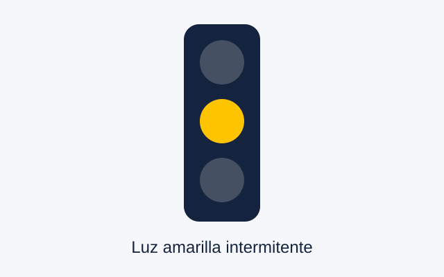
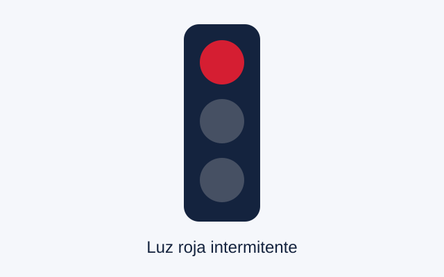

# Test de conducir Argentina: práctica general

50 preguntas originales para autos. Fuentes consultadas el 2026-10-21. No es un examen oficial.

Cada pregunta se responde dentro del marco nacional indicado. Revisar el régimen local para un examen municipal o provincial.

## 1. Un agente de tránsito te indica detenerte aunque el semáforo esté en verde. Según la Ley 24.449, ¿qué indicación debés respetar primero?

ID: `argentina-b1-001` · Tema: marco-y-requisitos

A) La luz verde, porque siempre prevalece.

B) La del agente que dirige el tránsito.

C) La maniobra del vehículo que circula adelante.

**Respuesta correcta:** La del agente que dirige el tránsito.

**Explicación:** El artículo 36 establece este orden: indicaciones de la autoridad, señales de tránsito y normas legales. La luz verde no permite ignorar al agente.

Fuente: [Ley 24.449, Ley de Tránsito, texto actualizado](https://www.argentina.gob.ar/normativa/nacional/818/actualizacion), Artículo 36

## 2. Antes de salir a la vía pública con un auto, ¿qué debés comprobar según la Ley 24.449?

ID: `argentina-b1-002` · Tema: marco-y-requisitos

A) Que tanto vos como el vehículo estén en condiciones adecuadas de seguridad.

B) Únicamente que haya combustible suficiente.

C) Solo que las luces delanteras enciendan.

**Respuesta correcta:** Que tanto vos como el vehículo estén en condiciones adecuadas de seguridad.

**Explicación:** La revisión previa incluye las condiciones del conductor y del vehículo. Poder poner en marcha el motor no demuestra que el conjunto sea seguro.

Fuente: [Ley 24.449, Ley de Tránsito, texto actualizado](https://www.argentina.gob.ar/normativa/nacional/818/actualizacion), Artículo 39 a

## 3. Según la Ley 24.449, ¿alcanza con tener una licencia de cualquier clase para manejar un automóvil?

ID: `argentina-b1-003` · Tema: marco-y-requisitos

A) Sí, si la licencia todavía no venció.

B) No; necesitás la habilitación correspondiente al tipo de vehículo.

C) Sí, si el titular del auto viaja como acompañante.

**Respuesta correcta:** No; necesitás la habilitación correspondiente al tipo de vehículo.

**Explicación:** La habilitación debe corresponder al vehículo conducido. La presencia de su dueño no reemplaza esa autorización.

Fuente: [Ley 24.449, Ley de Tránsito, texto actualizado](https://www.argentina.gob.ar/normativa/nacional/818/actualizacion), Artículo 40 a

## 4. ¿En qué formatos permite la Ley 24.449 exhibir el comprobante de seguro vigente?

ID: `argentina-b1-004` · Tema: marco-y-requisitos

A) Solo en una impresión en color.

B) Solo mediante el contrato original firmado por la aseguradora.

C) En papel impreso o en formato digital mediante un dispositivo electrónico.

**Respuesta correcta:** En papel impreso o en formato digital mediante un dispositivo electrónico.

**Explicación:** El artículo 40 admite ambos formatos. La pregunta se refiere al comprobante de un seguro vigente, no a cualquier archivo o fotografía sin respaldo.

Fuente: [Ley 24.449, Ley de Tránsito, texto actualizado](https://www.argentina.gob.ar/normativa/nacional/818/actualizacion), Artículo 40 c

## 5. Según la Ley 24.449, ¿cómo deben encontrarse las patentes del vehículo para circular?

ID: `argentina-b1-005` · Tema: marco-y-requisitos

A) Colocadas en los lugares reglamentarios, legibles y sin aditamentos.

B) Guardadas dentro del auto para evitar su deterioro.

C) Parcialmente cubiertas, siempre que se vea la última cifra.

**Respuesta correcta:** Colocadas en los lugares reglamentarios, legibles y sin aditamentos.

**Explicación:** La identificación de dominio debe poder leerse y cumplir las características reglamentarias. Llevar las placas sueltas dentro del habitáculo no cumple esa exigencia.

Fuente: [Ley 24.449, Ley de Tránsito, texto actualizado](https://www.argentina.gob.ar/normativa/nacional/818/actualizacion), Artículo 40 d

## 6. ¿Qué elementos exige la Ley 24.449 para circular en automóvil ante una eventual emergencia?

ID: `argentina-b1-006` · Tema: marco-y-requisitos

A) Solo una linterna y un chaleco de cualquier tipo.

B) Matafuego y balizas portátiles normalizados.

C) Únicamente las balizas eléctricas del vehículo.

**Respuesta correcta:** Matafuego y balizas portátiles normalizados.

**Explicación:** El artículo 40 exige matafuego y balizas portátiles normalizados. Las luces intermitentes del auto no sustituyen las balizas portátiles.

Fuente: [Ley 24.449, Ley de Tránsito, texto actualizado](https://www.argentina.gob.ar/normativa/nacional/818/actualizacion), Artículo 40 f

## 7. Un auto tiene capacidad para cinco personas. Según la Ley 24.449, ¿podrían viajar seis si el recorrido es corto?

ID: `argentina-b1-007` · Tema: marco-y-requisitos

A) Sí, si una persona viaja sobre las piernas de otra.

B) Sí, si no se circula por una ruta.

C) No; la cantidad de ocupantes debe respetar la capacidad del vehículo.

**Respuesta correcta:** No; la cantidad de ocupantes debe respetar la capacidad del vehículo.

**Explicación:** La cantidad de ocupantes debe ser compatible con la capacidad del vehículo y no estorbar al conductor. La distancia del viaje no crea una excepción.

Fuente: [Ley 24.449, Ley de Tránsito, texto actualizado](https://www.argentina.gob.ar/normativa/nacional/818/actualizacion), Artículo 40 g

## 8. En un automóvil con cinturones instalados, ¿quiénes deben utilizarlos según la Ley 24.449?

ID: `argentina-b1-008` · Tema: marco-y-requisitos

A) Solo quien conduce.

B) Solo quienes viajan en los asientos delanteros.

C) Todos sus ocupantes.

**Respuesta correcta:** Todos sus ocupantes.

**Explicación:** El uso del cinturón alcanza a los ocupantes, incluidos quienes viajan atrás. La protección no depende de la ubicación dentro del auto.

Fuente: [Ley 24.449, Ley de Tránsito, texto actualizado](https://www.argentina.gob.ar/normativa/nacional/818/actualizacion), Artículo 40 k

## 9. Según la reglamentación nacional, ¿cómo debe viajar un niño de seis años en un automóvil particular?

ID: `argentina-b1-009` · Tema: marco-y-requisitos

A) En el asiento trasero, con un sistema de retención infantil homologado adecuado a su peso y tamaño.

B) En el asiento delantero, usando únicamente el cinturón para adultos.

C) En brazos de un adulto que lleve el cinturón abrochado.

**Respuesta correcta:** En el asiento trasero, con un sistema de retención infantil homologado adecuado a su peso y tamaño.

**Explicación:** El marco nacional contempla el asiento trasero y la retención infantil correspondiente. Para rendir en una jurisdicción específica, verificá también sus requisitos de edad y talla.

Fuente: [Decreto 779/1995, Anexo 1, texto actualizado](https://www.argentina.gob.ar/normativa/recurso/30389/texactdto779-1995-anexo1/htm), Artículo 77 u; [Ley 24.449, Ley de Tránsito, texto actualizado](https://www.argentina.gob.ar/normativa/nacional/818/actualizacion), Artículo 40 g

## 10. Detectás una cubierta con fallas o sin la profundidad legal de dibujo. Según la Ley 24.449, ¿podés circular igualmente si vas despacio?

ID: `argentina-b1-010` · Tema: marco-y-requisitos

A) Sí, mientras no llueva.

B) Sí, por calles y hasta la próxima revisión técnica.

C) No; circular con cubiertas en esas condiciones está prohibido.

**Respuesta correcta:** No; circular con cubiertas en esas condiciones está prohibido.

**Explicación:** La prohibición se refiere al estado del neumático. Reducir la velocidad o contar con una revisión anterior no corrige el defecto.

Fuente: [Ley 24.449, Ley de Tránsito, texto actualizado](https://www.argentina.gob.ar/normativa/nacional/818/actualizacion), Artículo 48 l

## 11. En una encrucijada regida por la Ley 24.449, sin señales que indiquen otra cosa ni excepciones aplicables, ¿a quién debés ceder el paso?

ID: `argentina-b1-011` · Tema: prioridades-y-maniobras

A) Al vehículo que cruza desde tu derecha.

B) Al que se presenta por tu izquierda.

C) Al de mayor tamaño.

**Respuesta correcta:** Al vehículo que cruza desde tu derecha.

**Explicación:** La prioridad de la derecha es la regla general, pero tiene excepciones expresas. La pregunta excluye esas situaciones especiales.

Fuente: [Ley 24.449, Ley de Tránsito, texto actualizado](https://www.argentina.gob.ar/normativa/nacional/818/actualizacion), Artículo 41

## 12. Según la Ley 24.449, llegás desde una vía de tierra a una pavimentada. ¿Conservás la prioridad por presentarte desde la derecha?

ID: `argentina-b1-012` · Tema: prioridades-y-maniobras

A) No; esa situación es una excepción a la prioridad de la derecha.

B) Sí, sin importar la superficie de ambas vías.

C) Sí, si el otro vehículo es más pequeño.

**Respuesta correcta:** No; esa situación es una excepción a la prioridad de la derecha.

**Explicación:** El ingreso desde tierra a pavimento figura entre las circunstancias que hacen perder esa prioridad. No debe aplicarse la regla de la derecha de forma aislada.

Fuente: [Ley 24.449, Ley de Tránsito, texto actualizado](https://www.argentina.gob.ar/normativa/nacional/818/actualizacion), Artículo 41 g.1

## 13. Un peatón cruza lícitamente por la senda. Según la Ley 24.449, ¿qué debés hacer si tu avance lo pone en peligro?

ID: `argentina-b1-013` · Tema: prioridades-y-maniobras

A) Tocar bocina para que apresure el cruce.

B) Pasar por delante si calculás que queda espacio.

C) Detener el vehículo y cederle el paso.

**Respuesta correcta:** Detener el vehículo y cederle el paso.

**Explicación:** La prioridad del peatón que cruza lícitamente integra las excepciones a la prioridad vehicular. El conductor debe detenerse si su avance lo pone en peligro.

Fuente: [Ley 24.449, Ley de Tránsito, texto actualizado](https://www.argentina.gob.ar/normativa/nacional/818/actualizacion), Artículo 41 e

## 14. Según la Ley 24.449, un vehículo del servicio público de urgencia está cumpliendo su misión. ¿Podés exigirle paso solo porque venís desde su derecha?

ID: `argentina-b1-014` · Tema: prioridades-y-maniobras

A) No; el servicio de urgencia en cumplimiento de su misión es una excepción a esa prioridad.

B) Sí, porque la prioridad de la derecha nunca admite excepciones.

C) Sí, salvo que sea un vehículo de mayor tamaño.

**Respuesta correcta:** No; el servicio de urgencia en cumplimiento de su misión es una excepción a esa prioridad.

**Explicación:** La ley contempla expresamente a los servicios públicos de urgencia en cumplimiento de su misión. Esto no se extiende automáticamente a cualquier vehículo que use balizas.

Fuente: [Ley 24.449, Ley de Tránsito, texto actualizado](https://www.argentina.gob.ar/normativa/nacional/818/actualizacion), Artículo 41 c

## 15. Según la Ley 24.449 y sin señalización en contrario, ¿qué prioridad tiene un auto que ya circula en una rotonda frente a otro que intenta ingresar?

ID: `argentina-b1-015` · Tema: prioridades-y-maniobras

A) Debe ceder siempre al que está entrando.

B) Tiene prioridad sobre el que intenta ingresar.

C) La prioridad depende de cuál sea más grande.

**Respuesta correcta:** Tiene prioridad sobre el que intenta ingresar.

**Explicación:** El que circula por la rotonda tiene prioridad sobre el que ingresa. La misma norma indica que debe cederla al que egresa, salvo señalización en contrario.

Fuente: [Ley 24.449, Ley de Tránsito, texto actualizado](https://www.argentina.gob.ar/normativa/nacional/818/actualizacion), Artículo 43 e

## 16. Como regla general de la Ley 24.449, ¿por qué lado se realiza el adelantamiento a otro vehículo?

ID: `argentina-b1-016` · Tema: prioridades-y-maniobras

A) Por la izquierda.

B) Por la derecha en todos los casos.

C) Por cualquiera de los dos lados, indistintamente.

**Respuesta correcta:** Por la izquierda.

**Explicación:** La regla general es sobrepasar por la izquierda. La ley contempla situaciones excepcionales de adelantamiento por la derecha, que no convierten esa alternativa en una elección libre.

Fuente: [Ley 24.449, Ley de Tránsito, texto actualizado](https://www.argentina.gob.ar/normativa/nacional/818/actualizacion), Artículo 42, encabezado y h

## 17. Antes de iniciar un sobrepaso por la izquierda, ¿qué exige comprobar la Ley 24.449?

ID: `argentina-b1-017` · Tema: prioridades-y-maniobras

A) Solo que el vehículo de adelante circule más lento.

B) Únicamente que el auto tenga potencia suficiente.

C) Que haya distancia libre suficiente y que otro vehículo no te esté sobrepasando.

**Respuesta correcta:** Que haya distancia libre suficiente y que otro vehículo no te esté sobrepasando.

**Explicación:** La maniobra necesita espacio seguro y una comprobación de lo que ocurre detrás. La diferencia de velocidad por sí sola no autoriza a adelantar.

Fuente: [Ley 24.449, Ley de Tránsito, texto actualizado](https://www.argentina.gob.ar/normativa/nacional/818/actualizacion), Artículo 42 a

## 18. Te aproximás a una curva que limita la visibilidad. Según la Ley 24.449, ¿corresponde iniciar un sobrepaso?

ID: `argentina-b1-018` · Tema: prioridades-y-maniobras

A) Sí, si encendés las luces altas.

B) No; no debe iniciarse en esa aproximación peligrosa.

C) Sí, si el otro conductor reduce su velocidad.

**Respuesta correcta:** No; no debe iniciarse en esa aproximación peligrosa.

**Explicación:** La ley exige visibilidad suficiente y excluye iniciar el adelantamiento al aproximarse a curvas y otros lugares peligrosos. Señalizar no elimina el riesgo ni la prohibición.

Fuente: [Ley 24.449, Ley de Tránsito, texto actualizado](https://www.argentina.gob.ar/normativa/nacional/818/actualizacion), Artículo 42 b

## 19. Luego de sobrepasar, ¿cómo debés regresar a la derecha según la Ley 24.449?

ID: `argentina-b1-019` · Tema: prioridades-y-maniobras

A) Entrando de inmediato delante del otro vehículo, sin señalizar.

B) Con balizas, aunque obligues al otro auto a frenar.

C) Con el giro derecho encendido y sin interferir la marcha del vehículo sobrepasado.

**Respuesta correcta:** Con el giro derecho encendido y sin interferir la marcha del vehículo sobrepasado.

**Explicación:** El retorno debe señalizarse y dejar un margen que no interfiera con la circulación del vehículo adelantado. La maniobra no termina al quedar a su altura.

Fuente: [Ley 24.449, Ley de Tránsito, texto actualizado](https://www.argentina.gob.ar/normativa/nacional/818/actualizacion), Artículo 42 d

## 20. Otro conductor te advierte que va a sobrepasarte. Según la Ley 24.449, ¿qué corresponde hacer?

ID: `argentina-b1-020` · Tema: prioridades-y-maniobras

A) Acelerar para impedir que termine el adelantamiento.

B) Facilitar el sobrepaso, mantenerte a la derecha y mantener o reducir la velocidad si hace falta.

C) Desplazarte hacia la izquierda para cerrar el espacio.

**Respuesta correcta:** Facilitar el sobrepaso, mantenerte a la derecha y mantener o reducir la velocidad si hace falta.

**Explicación:** El conductor sobrepasado también debe contribuir a la seguridad de la maniobra. Acelerar o cerrar el paso dificulta su finalización.

Fuente: [Ley 24.449, Ley de Tránsito, texto actualizado](https://www.argentina.gob.ar/normativa/nacional/818/actualizacion), Artículo 42 e

## 21. Según la Ley 24.449, el semáforo está en rojo y no hay un agente dando otra indicación. ¿Dónde debés detenerte?

ID: `argentina-b1-021` · Tema: semaforos-y-vias

A) Sobre la senda, si no hay peatones.

B) Dentro del cruce, sin llegar al otro carril.

C) Antes de la línea de detención o de la senda peatonal.

**Respuesta correcta:** Antes de la línea de detención o de la senda peatonal.

**Explicación:** La luz roja exige detenerse antes del espacio reservado para el cruce. Que la senda esté momentáneamente vacía no habilita a ocuparla.

Fuente: [Ley 24.449, Ley de Tránsito, texto actualizado](https://www.argentina.gob.ar/normativa/nacional/818/actualizacion), Artículo 44 a.2

## 22. Según la Ley 24.449, aparece la luz amarilla fija y estimás que no terminarías de atravesar la intersección antes del rojo. ¿Qué corresponde?

ID: `argentina-b1-022` · Tema: semaforos-y-vias

A) Acelerar para intentar pasar de todos modos.

B) Detenerte antes de ingresar al cruce.

C) Continuar porque el amarillo equivale al verde.

**Respuesta correcta:** Detenerte antes de ingresar al cruce.

**Explicación:** La regla nacional ordena detenerse si se estima que no se alcanzará a transponer la encrucijada antes de la luz roja. No es una invitación a acelerar.

Fuente: [Ley 24.449, Ley de Tránsito, texto actualizado](https://www.argentina.gob.ar/normativa/nacional/818/actualizacion), Artículo 44 a.3

## 23. Según la Ley 24.449, ¿cómo se atraviesa un cruce con luz amarilla intermitente?

ID: `argentina-b1-023` · Tema: semaforos-y-vias

A) Con prioridad asegurada sobre todo el resto del tránsito.

B) Acelerando para reducir el tiempo dentro del cruce.

C) Con precaución, por tratarse de un cruce riesgoso.

**Respuesta correcta:** Con precaución, por tratarse de un cruce riesgoso.

**Explicación:** La luz amarilla intermitente advierte riesgo. No otorga por sí misma una prioridad que permita desatender a los demás usuarios.

Fuente: [Ley 24.449, Ley de Tránsito, texto actualizado](https://www.argentina.gob.ar/normativa/nacional/818/actualizacion), Artículo 44 a.4

## 24. Según la Ley 24.449, ¿qué exige una luz roja intermitente?

ID: `argentina-b1-024` · Tema: semaforos-y-vias

A) Reducir un poco la velocidad sin detenerse.

B) Continuar si el vehículo de atrás toca bocina.

C) Detenerse y reiniciar la marcha solo cuando no exista riesgo.

**Respuesta correcta:** Detenerse y reiniciar la marcha solo cuando no exista riesgo.

**Explicación:** A diferencia de la amarilla intermitente, la roja exige una detención. Después es necesario comprobar que continuar no genere riesgo.

Fuente: [Ley 24.449, Ley de Tránsito, texto actualizado](https://www.argentina.gob.ar/normativa/nacional/818/actualizacion), Artículo 44 a.5

## 25. Tenés luz verde, pero no hay espacio después de la intersección para que tu auto la despeje. Según la Ley 24.449, ¿qué debés hacer?

ID: `argentina-b1-025` · Tema: semaforos-y-vias

A) Esperar antes de ingresar hasta disponer de espacio suficiente.

B) Avanzar y quedarte en medio del cruce.

C) Ingresar si mantenés encendidas las balizas.

**Respuesta correcta:** Esperar antes de ingresar hasta disponer de espacio suficiente.

**Explicación:** La luz verde no autoriza a bloquear la intersección. La ley exige que exista espacio suficiente del otro lado para completar el cruce.

Fuente: [Ley 24.449, Ley de Tránsito, texto actualizado](https://www.argentina.gob.ar/normativa/nacional/818/actualizacion), Artículo 44 e

## 26. En una vía con tres carriles de circulación por mano, ¿cómo indica la Ley 24.449 que debés mantener el auto dentro del carril?

ID: `argentina-b1-026` · Tema: semaforos-y-vias

A) Sobre la línea divisoria para ocupar parcialmente dos carriles.

B) Por el centro, permaneciendo en un mismo carril.

C) Cambiando constantemente de carril aunque no sea necesario.

**Respuesta correcta:** Por el centro, permaneciendo en un mismo carril.

**Explicación:** Mantener una trayectoria definida facilita que los demás anticipen el movimiento del vehículo. Los cambios se realizan cuando corresponden y deben advertirse.

Fuente: [Ley 24.449, Ley de Tránsito, texto actualizado](https://www.argentina.gob.ar/normativa/nacional/818/actualizacion), Artículo 45 b

## 27. En una vía multicarril, ¿cuándo debés usar la luz de giro para cambiar de carril según la Ley 24.449?

ID: `argentina-b1-027` · Tema: semaforos-y-vias

A) Antes de la maniobra, con anticipación.

B) Solo después de ocupar el nuevo carril.

C) Únicamente durante la noche.

**Respuesta correcta:** Antes de la maniobra, con anticipación.

**Explicación:** El aviso debe preceder al desplazamiento. Encender el giro no concede prioridad ni reemplaza comprobar que el cambio pueda hacerse con seguridad.

Fuente: [Ley 24.449, Ley de Tránsito, texto actualizado](https://www.argentina.gob.ar/normativa/nacional/818/actualizacion), Artículo 45 c; 39 b

## 28. En una autopista regida por la Ley 24.449, ¿podés detenerte sobre un carril para que baje un acompañante?

ID: `argentina-b1-028` · Tema: semaforos-y-vias

A) Sí, durante unos segundos y con balizas.

B) No; el ascenso o descenso solo puede hacerse en las dársenas construidas para ello, si existen.

C) Sí, si elegís el carril derecho.

**Respuesta correcta:** No; el ascenso o descenso solo puede hacerse en las dársenas construidas para ello, si existen.

**Explicación:** La ley prohíbe detenerse o estacionar para esa finalidad fuera de los espacios previstos. Las balizas no habilitan una detención de conveniencia.

Fuente: [Ley 24.449, Ley de Tránsito, texto actualizado](https://www.argentina.gob.ar/normativa/nacional/818/actualizacion), Artículo 46 c

## 29. Según la Ley 24.449, ¿puede circular una bicicleta por una autopista?

ID: `argentina-b1-029` · Tema: semaforos-y-vias

A) Sí, si lleva luces y casco.

B) No; los vehículos propulsados por el conductor están excluidos.

C) Sí, siempre que use la banquina.

**Respuesta correcta:** No; los vehículos propulsados por el conductor están excluidos.

**Explicación:** La autopista está reservada para los tipos de vehículos admitidos. El equipamiento de seguridad de una bicicleta no modifica esa exclusión.

Fuente: [Ley 24.449, Ley de Tránsito, texto actualizado](https://www.argentina.gob.ar/normativa/nacional/818/actualizacion), Artículo 46 b

## 30. Un auto es remolcado por una avería en una autopista. Según la Ley 24.449, ¿cuándo debe abandonar esa vía?

ID: `argentina-b1-030` · Tema: semaforos-y-vias

A) En la primera salida.

B) Solo cuando llegue a su destino final.

C) Después de recorrer al menos diez kilómetros.

**Respuesta correcta:** En la primera salida.

**Explicación:** Para los vehículos remolcados por avería o accidente, la ley establece la salida de la autopista en el primer egreso disponible.

Fuente: [Ley 24.449, Ley de Tránsito, texto actualizado](https://www.argentina.gob.ar/normativa/nacional/818/actualizacion), Artículo 46 d

## 31. Con lluvia y visibilidad reducida, ¿alcanza con respetar el máximo indicado para cumplir la velocidad precautoria de la Ley 24.449?

ID: `argentina-b1-031` · Tema: velocidades

A) No; debés adaptar la velocidad para conservar el dominio del vehículo.

B) Sí; la máxima siempre es segura en cualquier condición.

C) Sí, si circulás por el carril derecho.

**Respuesta correcta:** No; debés adaptar la velocidad para conservar el dominio del vehículo.

**Explicación:** La velocidad precautoria considera visibilidad, vía, tránsito, vehículo y conductor. Puede ser necesario circular por debajo del máximo permitido.

Fuente: [Ley 24.449, Ley de Tránsito, texto actualizado](https://www.argentina.gob.ar/normativa/nacional/818/actualizacion), Artículo 50

## 32. Según el límite general de la Ley 24.449, ¿cuál es la máxima en una calle urbana, sin señalización ni situaciones que establezcan otro límite?

ID: `argentina-b1-032` · Tema: velocidades

A) 40 km/h.

B) 60 km/h.

C) 80 km/h.

**Respuesta correcta:** 40 km/h.

**Explicación:** La máxima general nacional para calles urbanas es 40 km/h. La señalización y las situaciones especiales pueden exigir una velocidad distinta; verificá también el régimen local.

Fuente: [Ley 24.449, Ley de Tránsito, texto actualizado](https://www.argentina.gob.ar/normativa/nacional/818/actualizacion), Artículo 51 a.1

## 33. Según el límite general de la Ley 24.449, ¿cuál es la máxima en una avenida urbana sin otra señalización, semaforización coordinada ni límite especial?

ID: `argentina-b1-033` · Tema: velocidades

A) 40 km/h.

B) 60 km/h.

C) 90 km/h.

**Respuesta correcta:** 60 km/h.

**Explicación:** El valor general nacional para avenidas es 60 km/h. No se debe trasladar este número a cualquier avenida sin revisar su señalización y las condiciones aplicables.

Fuente: [Ley 24.449, Ley de Tránsito, texto actualizado](https://www.argentina.gob.ar/normativa/nacional/818/actualizacion), Artículo 51 a.2

## 34. Según la Ley 24.449, ¿cuál es la máxima general para un automóvil particular sin remolque en un camino rural que no es autopista ni semiautopista, sin otro límite aplicable?

ID: `argentina-b1-034` · Tema: velocidades

A) 130 km/h.

B) 80 km/h.

C) 110 km/h.

**Respuesta correcta:** 110 km/h.

**Explicación:** La categoría de vehículo y el tipo de vía importan. Para este automóvil en zona rural, el máximo general es 110 km/h; no es un objetivo obligatorio de velocidad.

Fuente: [Ley 24.449, Ley de Tránsito, texto actualizado](https://www.argentina.gob.ar/normativa/nacional/818/actualizacion), Artículo 51 b.1

## 35. Según la Ley 24.449, ¿cuál es la máxima general para un automóvil particular sin remolque en una semiautopista, sin otra limitación aplicable?

ID: `argentina-b1-035` · Tema: velocidades

A) 110 km/h.

B) 120 km/h.

C) 130 km/h.

**Respuesta correcta:** 120 km/h.

**Explicación:** La ley fija para automóviles y motocicletas un máximo general de 120 km/h en semiautopistas. Deben respetarse los límites señalizados y la velocidad precautoria.

Fuente: [Ley 24.449, Ley de Tránsito, texto actualizado](https://www.argentina.gob.ar/normativa/nacional/818/actualizacion), Artículo 51 c

## 36. Según la Ley 24.449, ¿cuál es la máxima general para un automóvil particular sin remolque en una autopista, sin otra limitación aplicable?

ID: `argentina-b1-036` · Tema: velocidades

A) 120 km/h.

B) 150 km/h.

C) 130 km/h.

**Respuesta correcta:** 130 km/h.

**Explicación:** Ese máximo nacional corresponde a automóviles y motocicletas en autopistas. No significa que toda autopista permita circular a 130 km/h ni que otras categorías tengan el mismo límite.

Fuente: [Ley 24.449, Ley de Tránsito, texto actualizado](https://www.argentina.gob.ar/normativa/nacional/818/actualizacion), Artículo 51 d

## 37. Según la Ley 24.449, ¿qué velocidad corresponde al atravesar una encrucijada urbana sin semáforo?

ID: `argentina-b1-037` · Tema: velocidades

A) La máxima de la avenida, aunque sea superior a 30 km/h.

B) Siempre 40 km/h, sin necesidad de reducir.

C) Una velocidad precautoria que no supere 30 km/h.

**Respuesta correcta:** Una velocidad precautoria que no supere 30 km/h.

**Explicación:** El máximo especial nacional para esta situación es 30 km/h. Además, debe elegirse una velocidad precautoria y respetarse la prioridad que corresponda.

Fuente: [Ley 24.449, Ley de Tránsito, texto actualizado](https://www.argentina.gob.ar/normativa/nacional/818/actualizacion), Artículo 51 e.1

## 38. Según la Ley 24.449, ¿cómo debés atravesar un paso a nivel sin barrera ni semáforos?

ID: `argentina-b1-038` · Tema: velocidades

A) A 40 km/h si no se escucha una bocina.

B) Sin reducir, porque no hay barrera que obligue a parar.

C) A velocidad precautoria no superior a 20 km/h, después de comprobar que no venga un tren.

**Respuesta correcta:** A velocidad precautoria no superior a 20 km/h, después de comprobar que no venga un tren.

**Explicación:** La ausencia de dispositivos no elimina el riesgo ferroviario. La ley combina un máximo especial de 20 km/h con la comprobación de que no se aproxime un tren.

Fuente: [Ley 24.449, Ley de Tránsito, texto actualizado](https://www.argentina.gob.ar/normativa/nacional/818/actualizacion), Artículo 51 e.2

## 39. Según la Ley 24.449, al pasar cerca de una escuela durante su funcionamiento, ¿cuál es el límite especial indicado?

ID: `argentina-b1-039` · Tema: velocidades

A) Siempre 40 km/h, por ser una calle.

B) 60 km/h si se circula por una avenida.

C) Velocidad precautoria no mayor a 20 km/h.

**Respuesta correcta:** Velocidad precautoria no mayor a 20 km/h.

**Explicación:** El límite nacional especial durante el funcionamiento del establecimiento es 20 km/h. Se debe atender también a las personas, la señalización y las reglas locales aplicables.

Fuente: [Ley 24.449, Ley de Tránsito, texto actualizado](https://www.argentina.gob.ar/normativa/nacional/818/actualizacion), Artículo 51 e.3

## 40. De día, en una ruta nacional y sin circunstancias que exijan otra iluminación, ¿qué admite la reglamentación nacional?

ID: `argentina-b1-040` · Tema: luces

A) Circular únicamente con las luces de posición.

B) Circular con luces bajas o con luces diurnas DRL encendidas.

C) Circular sin luces si hay buen sol.

**Respuesta correcta:** Circular con luces bajas o con luces diurnas DRL encendidas.

**Explicación:** La reglamentación admite DRL como alternativa diurna en rutas nacionales. De noche exige luces bajas, salvo cuando corresponde utilizar altas; las luces de posición solas no cumplen la regla.

Fuente: [Decreto 779/1995, Anexo 1, texto actualizado](https://www.argentina.gob.ar/normativa/recurso/30389/texactdto779-1995-anexo1/htm), Artículo 47 a y h; [Ley 24.449, Ley de Tránsito, texto actualizado](https://www.argentina.gob.ar/normativa/nacional/818/actualizacion), Artículo 47 a y c

## 41. Circulás con luces altas y se aproxima un vehículo en sentido contrario. Según la reglamentación nacional, ¿qué debés hacer?

ID: `argentina-b1-041` · Tema: luces

A) Mantener las altas hasta quedar a su lado.

B) Cambiar a bajas con distancia suficiente para no encandilar.

C) Apagar todas las luces durante el cruce.

**Respuesta correcta:** Cambiar a bajas con distancia suficiente para no encandilar.

**Explicación:** El cambio debe hacerse antes de cruzarse y con anticipación suficiente. Se busca evitar que el otro conductor pierda visión por el encandilamiento.

Fuente: [Decreto 779/1995, Anexo 1, texto actualizado](https://www.argentina.gob.ar/normativa/recurso/30389/texactdto779-1995-anexo1/htm), Artículo 47 b

## 42. Según la Ley 24.449, ¿es necesario usar las luces de giro para una maniobra aunque sea pleno día?

ID: `argentina-b1-042` · Tema: luces

A) No; solo son obligatorias con poca visibilidad.

B) Sí; deben usarse conforme a su finalidad aunque haya luz natural suficiente.

C) Solo si el vehículo de atrás está muy cerca.

**Respuesta correcta:** Sí; deben usarse conforme a su finalidad aunque haya luz natural suficiente.

**Explicación:** Las luces de giro comunican una maniobra, no sirven únicamente para iluminar. Por eso deben funcionar también de día cuando corresponde señalizar.

Fuente: [Ley 24.449, Ley de Tránsito, texto actualizado](https://www.argentina.gob.ar/normativa/nacional/818/actualizacion), Artículo 47 g

## 43. Según el texto vigente del artículo 48 de la Ley 24.449, ¿qué nivel de alcohol en sangre está permitido para conducir?

ID: `argentina-b1-043` · Tema: riesgos-y-convivencia

A) Hasta 0,5 g/l para cualquier automóvil particular.

B) Cero: se prohíbe conducir con alcoholemia superior a cero.

C) Hasta 0,2 g/l si el recorrido es corto.

**Respuesta correcta:** Cero: se prohíbe conducir con alcoholemia superior a cero.

**Explicación:** La Ley 27.714 modificó el artículo 48 e incorporó alcohol cero. Esta pregunta evalúa el marco nacional citado; no afirma que todos los regímenes locales tengan idéntica redacción.

Fuente: [Ley 24.449, Ley de Tránsito, texto actualizado](https://www.argentina.gob.ar/normativa/nacional/818/actualizacion), Artículo 48 a

## 44. Tomaste un medicamento que disminuye tu aptitud para conducir. Según la Ley 24.449, ¿podés manejar porque fue recetado?

ID: `argentina-b1-044` · Tema: riesgos-y-convivencia

A) No; la prescripción no habilita a conducir con la aptitud disminuida.

B) Sí, cualquier medicamento recetado permite manejar.

C) Sí, siempre que vayas por debajo de 40 km/h.

**Respuesta correcta:** No; la prescripción no habilita a conducir con la aptitud disminuida.

**Explicación:** La prohibición incluye medicamentos que afecten la aptitud para conducir. Que un tratamiento sea legítimo no elimina sus posibles efectos sobre la conducción.

Fuente: [Ley 24.449, Ley de Tránsito, texto actualizado](https://www.argentina.gob.ar/normativa/nacional/818/actualizacion), Artículo 48 a

## 45. Mientras conducís, querés escribir y enviar un mensaje sosteniendo el celular. Según la Ley 24.449, ¿está permitido?

ID: `argentina-b1-045` · Tema: riesgos-y-convivencia

A) No; implica utilizar manualmente un sistema de comunicación durante la conducción.

B) Sí, si escribís con una sola mano.

C) Sí, cuando el tránsito avanza lentamente.

**Respuesta correcta:** No; implica utilizar manualmente un sistema de comunicación durante la conducción.

**Explicación:** La norma prohíbe conducir utilizando sistemas de comunicación de operación manual continua. Ir despacio o sostener el volante con una mano no habilita esa conducta.

Fuente: [Ley 24.449, Ley de Tránsito, texto actualizado](https://www.argentina.gob.ar/normativa/nacional/818/actualizacion), Artículo 48 x

## 46. Hay una fila de autos detenidos y no existe una emergencia. Según la Ley 24.449, ¿podés avanzar por la banquina para evitarlos?

ID: `argentina-b1-046` · Tema: riesgos-y-convivencia

A) Sí, si usás las balizas.

B) No; la congestión no habilita a circular por la banquina.

C) Sí, durante un máximo de cien metros.

**Respuesta correcta:** No; la congestión no habilita a circular por la banquina.

**Explicación:** La excepción para circular por la banquina se refiere a emergencias. Evitar una demora no constituye esa circunstancia.

Fuente: [Ley 24.449, Ley de Tránsito, texto actualizado](https://www.argentina.gob.ar/normativa/nacional/818/actualizacion), Artículo 48 c

## 47. Según la reglamentación nacional, ¿qué separación temporal mínima debe mantener un auto respecto del vehículo que lo precede en su carril?

ID: `argentina-b1-047` · Tema: riesgos-y-convivencia

A) Siempre un segundo, incluso con lluvia.

B) Medio segundo si ambos autos tienen ABS.

C) Por lo menos dos segundos, ampliándola si las condiciones lo requieren.

**Respuesta correcta:** Por lo menos dos segundos, ampliándola si las condiciones lo requieren.

**Explicación:** El mínimo reglamentario es de dos segundos y debe resultar prudente según la velocidad, la calzada y el clima. El equipamiento no elimina la necesidad de distancia.

Fuente: [Decreto 779/1995, Anexo 1, texto actualizado](https://www.argentina.gob.ar/normativa/recurso/30389/texactdto779-1995-anexo1/htm), Artículo 48 g

## 48. La barrera de un paso a nivel está bajando. Según la Ley 24.449, ¿podés cruzar si todavía queda espacio debajo?

ID: `argentina-b1-048` · Tema: riesgos-y-convivencia

A) No; está prohibido cruzar con las barreras bajas o en movimiento.

B) Sí, si no se ve el tren desde tu posición.

C) Sí, si el vehículo de adelante acaba de pasar.

**Respuesta correcta:** No; está prohibido cruzar con las barreras bajas o en movimiento.

**Explicación:** La barrera en movimiento es una advertencia que impide iniciar el cruce. También está prohibido cruzar si la salida no está libre o se advierte la proximidad de un tren.

Fuente: [Ley 24.449, Ley de Tránsito, texto actualizado](https://www.argentina.gob.ar/normativa/nacional/818/actualizacion), Artículo 48 k

## 49. Según la Ley 24.449, si participás en un siniestro de tránsito, ¿qué obligación inmediata tenés?

ID: `argentina-b1-049` · Tema: siniestros

A) Detenerte inmediatamente.

B) Continuar si el daño parece pequeño.

C) Alejarte y decidir después si corresponde informar.

**Respuesta correcta:** Detenerte inmediatamente.

**Explicación:** La obligación de detenerse alcanza a quienes participan del hecho. Un daño que parece menor no autoriza a abandonar el lugar sin cumplir las obligaciones legales.

Fuente: [Ley 24.449, Ley de Tránsito, texto actualizado](https://www.argentina.gob.ar/normativa/nacional/818/actualizacion), Artículo 65 a

## 50. Después de un siniestro, ¿qué datos exige la Ley 24.449 suministrar a la otra parte y a la autoridad interviniente?

ID: `argentina-b1-050` · Tema: siniestros

A) Los datos de la licencia de conducir y del seguro obligatorio.

B) Solo un nombre de pila y un teléfono.

C) Únicamente la marca y el color del vehículo.

**Respuesta correcta:** Los datos de la licencia de conducir y del seguro obligatorio.

**Explicación:** La ley exige identificar la licencia y el seguro. Si la otra parte no está presente, contempla dejar esos datos eficazmente adheridos al vehículo dañado.

Fuente: [Ley 24.449, Ley de Tránsito, texto actualizado](https://www.argentina.gob.ar/normativa/nacional/818/actualizacion), Artículo 65 b
